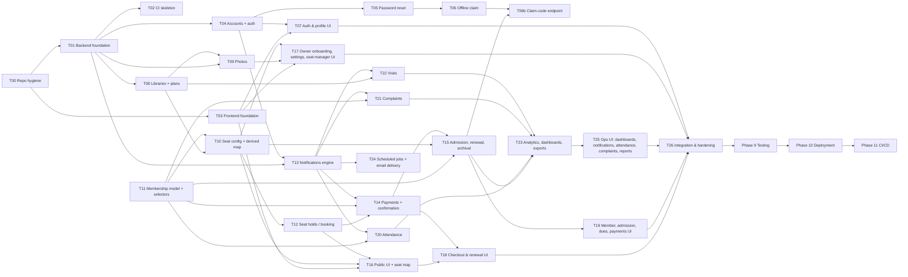

# LibraryHive — Implementation Plan (Phase 7)

**Version:** 1.0
**Date:** 2026-10-09
**Status:** **APPROVED** (2026-10-09). Later decisions recorded on 2026-10-09: D15 (team), external-dependency notes, and **D19: fresh implementation from the approved design** (legacy application code retired; see T00 and §5).
**Builds on (all approved):** `FEATURES.md` v2.2 · `ARCHITECTURE.md` · `SPEC.md` v2.0 · `BACKEND_ARCHITECTURE.md` (endpoint numbers `#n`) · `UI_ARCHITECTURE.md` · `SECURITY.md` (SEC-1 approved)

This plan says **who builds what, in which order, and how we know it is done**. No code is written in this phase.

---

## 1. Planning principles

1. **One owner per backend app and per frontend area.** Every task has exactly one owner; nobody edits another owner's app except through a reviewed PR that the owner approves.
2. **Contracts first.** The data model (`SPEC.md`) and API contract (`BACKEND_ARCHITECTURE.md` §9) are frozen. Any change goes through the contract-change rule in §7.
3. **Dependency order, P0 before P1.** P1 items in a module start only after that module's P0 items are done.
4. **No stubs, no fake data in product code** (AGENTS §1.3). If a dependency is not ready, the dependent feature waits or is merged without that part. It never ships a placeholder value. Test doubles are allowed only in tests (gateway, email).
5. **Every task ends green:** tests, lint, type check and build pass, and the task's checklist in `ARCHITECTURE.md` §23.1 (old code removed) is done.
6. **Fresh implementation from the approved design (D19, 2026-10-09).** The application code written before the approved design is retired (preserved in `legacy/*` tags). Every module is built from `SPEC.md`, `BACKEND_ARCHITECTURE.md` and `UI_ARCHITECTURE.md`. A legacy piece may be reused only if it is explicitly verified against the approved contract and the reuse is stated in the PR description.

---

## 2. Team assignment (final)

`FEATURES.md` gave tentative owners per feature. Assigning **by app** (the rule in `ARCHITECTURE.md` §8.1) changes a few of them; the changes are listed in §2.2 and `FEATURES.md` is updated to match.

### 2.1 Ownership map

| Person | Area | Backend apps | Frontend areas | Main features |
|---|---|---|---|---|
| **P1: Platform & Identity** | Foundation, security, auth, logging, CI, deployment | `core`, `accounts`, `config/` | Frontend foundation (`components/ui`, `components/layout`, `lib/api-client.ts`, `lib/auth*`, providers, `next.config`), auth pages, profile pages | AUTH-*, OFF-04, LOG-01..06/08/10/11, NFR-01/02/06/07/08 |
| **P2: Library & Seats** | Library profile, photos, discovery, seat configuration, seat holds, seat map, visits | `libraries`, `seats`, `visits` | Landing, discover, library page, `components/seat-map`, `components/library`, owner onboarding, library settings, seat manager, visit screens | LIB-*, PHO-*, DIS-*, SEAT-*, BOOK-01..05/07, DEMO-* |
| **P3: Membership & Payments** | Memberships, offline admission, renewals, archival, payments, dues | `memberships`, `payments` | Checkout and renewal, `components/booking`, student memberships and payments, owner members, admission, dues, payments | MEM-*, OFF-01/02/03/05, PAY-*, BOOK-06 |
| **P4: Operations & Insights** | Notifications, attendance, complaints, dashboards, reports | `notifications`, `attendance`, `complaints`, `analytics` | Dashboards (owner, student), notifications, attendance, complaints, reports, activity log, `components/charts` | NOT-*, ATT-*, CMP-*, DASH-*, LOG-07, LOG-09 |

**Team (D15, decided 2026-10-09):** **P1 = Divyanshi · P2 = Priya · P3 = Jagriti · P4 = Ritesh.** Person C (the earlier booking/payment/membership role) has no unpushed work to preserve.

**Who wrote the existing code (from git history, for hand-over):** Priya Saini, initial setup (core, accounts, libraries) and the unmerged `complaints-work` branch · Rathourdivyanshi6398, Person A owner setup and Person B discovery/seat map (Person B commits not yet pushed) · RITESH JHA, bookings, payments, memberships and notifications on `main` · Jagritipandey625, discovery and explore pages on `main` and the unmerged seat-map branch. Under D15, several areas are now owned by someone other than their original author (e.g. payments written by Ritesh are owned by Jagriti as P3; discovery written by Jagriti is owned by Priya as P2; complaints written by Priya are owned by Ritesh as P4). The original author is asked to review the first PR that restructures their code (§7).

### 2.2 Changes from the tentative owners in FEATURES.md (and why)

| Feature(s) | Was | Now | Reason |
|---|---|---|---|
| LIB-*, PHO-*, SEAT-01/02/04/07 | P1 | **P2** | `libraries` and `seats` become one owner's domain (P2 already owned the seat map, discovery and the explore page). P1 takes the platform foundation, which is on everyone's critical path. |
| BOOK-01..05, SEAT-03, SEAT-09 | P3 / P2 | **P2** | Holds live in the `seats` app; the seat-lock protocol (SPEC §4.1) should have one owner. P3 calls `seats.services` when confirming payments and admissions. |
| OFF-04 (claim) | P3 | **P1** | The claim uses `AccountClaim` in `accounts`, shared with password reset (AUTH-15). P3's admission UI calls P1's claim-code endpoint (#55). |
| NOT-*, LOG-09 | P3 | **P4** | Balances load: P3 carries the payment and booking-confirmation complexity. Notifications are a cross-cutting service every app calls. |
| PAY-10/11 (dues) | P4 | **P3** | Dues are derived from `memberships` and live in `payments` (#49). |
| MEM-06/08 UI | P4 | **P3** | Archival lives on the member detail screen, which P3 builds. |
| NFR-04 (fake-data removal) | P1 (setup) / P2 | **P2** | All three existing pages (discover, library page, owner setup) are rebuilt by P2. |

### 2.3 Shared files (one owner, others contribute by PR)

| File / area | Owner | Rule |
|---|---|---|
| `backend/config/settings/*`, `config/urls.py`, `requirements*.txt` | P1 | Others add their app's URL include, settings and dependencies via PR |
| `backend/apps/core/*` | P1 | Changes affect everyone; needs a second reviewer |
| `frontend/components/ui/*`, `components/layout/*`, `lib/api-client.ts`, `lib/auth*`, `next.config.mjs` | P1 | New UI kit components are requested from P1 or added by PR with P1's review |
| `frontend/lib/api-types.gen.ts` | generated | Regenerated by whoever changes an endpoint; CI checks freshness |
| `frontend/lib/api/<app>.ts`, `lib/schemas/<area>.ts` | the app's owner | — |
| `run_scheduled_jobs` command (orchestrator) | P4 | Each step function is owned by its app owner: `expire_holds` (P2), `reconcile_payments` (P3), `renewal_notifications` / `owner_summaries` / `send_emails` / `auto_close_attendance` (P4) |
| `seed_demo` management command (replaces `seed_libraries`) | P1 | Each owner provides `apps/<app>/seed.py` creating realistic demo data **through their services** |
| `README.md`, `.env.example` files, CI workflows | P1 | — |

---

## 3. Milestones and dependency order

The brief's suggested order (foundation → … → deployment) is followed. Work runs in parallel wherever the dependency graph allows.

| Milestone | Tasks | Exit criterion |
|---|---|---|
| **M0 Foundation** | T00–T03 | Fresh clone runs backend (PostgreSQL) and frontend with documented commands; CI green; envelope, logging, audit and UI kit usable by everyone |
| **M1 Identity & library** | T04–T10, T13 | Owner can register, log in, create a library with plans, seats and photos; library appears in discovery; seat map shows derived status; notifications engine available |
| **M2 Booking & money** | T11, T12, T14, T15, T06b | Student can hold a seat and pay in Razorpay test mode; owner can admit an offline student with cash; renewals and archival work; claim flow works end to end |
| **M3 Operations** | T20–T24 | Attendance, complaints, visits, dashboards, reports, exports and scheduled jobs work |
| **M4 Frontend complete** | T07, T16–T19, T25 | Every screen in `UI_ARCHITECTURE.md` implemented with all four states |
| **M5 Integration** | T26 | All flows pass end to end; isolation and security checklists pass; no obsolete code remains; ready for Phase 9 |

**Effort sizes** (relative): S ≈ 1–2 days, M ≈ 3–5 days, L ≈ 6–10 days of focused work for one person. A calendar is **NOT SPECIFIED — REQUIRES DECISION**: it depends on the team's weekly hours and deadline (§9).

---

## 4. Tasks

Branch names follow `AGENTS.md` §10: **`feature/<task-name>`** (one short-lived branch per task, from the latest `main`, deleted after merge), `fix/<issue>` for fixes, `docs/<doc>` for documentation, `chore/<topic>` for repository maintenance. Every task's tests run against **PostgreSQL**.

## Status checklist (2026-10-19)

State of every task on the working branch `integration/payments-base`. "Done" means the task's backend and
frontend scope is built and its tests pass; **nothing after T14 is committed yet** (T15 onward is in the working
tree for review). Checks were run on 2026-10-19: backend 636 tests, frontend 208 tests, lint, type check and
`next build` all pass; OpenAPI validates with no warnings.

| Task | State | Notes |
|---|---|---|
| T00-T05 | Done on `main` | Foundation, CI, frontend foundation, accounts, password reset |
| T06 account claim | **On `origin/main` only**, not on this branch | Needs `main` merged here (not authorised yet) |
| T06b claim-code endpoint (#55) | **Blocked** by T06 | Depends on the `AccountClaim` claim code from T06 |
| T07 auth and profile screens | **On `feature/auth-ui` only**, not on this branch | Login, register, reset, claim and profile screens live there |
| T08, T09 libraries, photos | Done | |
| T10 seats | Done | Seat status derived, never stored |
| T11 membership model | Done | |
| T12 seat holds | Done | Owner-release notification is a **pending decision** (below) |
| T13 notifications engine | Done | |
| T14 payments | Done, committed (`c5a476c`) | Real Razorpay test payment is **pending credentials** (below) |
| T15 admission, renewal, archival | Done, uncommitted | Archive notification is a **pending decision** |
| T16 public screens and seat map | Done except the map/geocoding extras | Seat map and booking panel built; `LibraryMap`, `LocationPicker`, `lib/geocode.ts` not built (Leaflet not installed; geocoding needs decision U2) |
| T17 owner onboarding, settings, seat manager | Done | Onboarding is five steps (profile, plans, photos, seats, live) |
| T18 checkout and renewal | Done | Automated against a mocked payment window; manual Razorpay staging check **pending** |
| T19 membership, admission, dues, payments screens | Done except claim-code display | Claim code needs T06b |
| T20 attendance | Done | Includes auto-close and closing the open record on archival |
| T21 complaints | Done except the photo (CMP-06, P1) | Photo needs private object storage |
| T22 visits | Done | Backend and screens |
| T23 analytics, dashboards, exports | Done | `domain_breakdown` on the public #15 is **not** added (owner dashboard has it) |
| T24 scheduled jobs and email | Done | `run_scheduled_jobs`, fallback trigger #4 |
| T25 operations screens | Done | |
| T26 integration | Partly | `seed_demo` and an end-to-end API journey test done; Playwright suite and the SECURITY section 20 checklist run are **not** done |

### Open decisions and external blockers

1. **Owner-release notification (T12).** SPEC 3.13 lists no notification type and SPEC 4.5 no dedup key for it. Not implemented, nothing invented. Needs a SPEC-backed type name, recipient and key.
2. **Archive notification (T15, #52 says the student is notified).** Same gap in SPEC 3.13 / 4.5. The archive itself, the audit entry and the closing of an open attendance record are done; the notification is not sent.
3. **Real Razorpay test-mode payment (T14, T18).** `RAZORPAY_KEY_ID`, `RAZORPAY_KEY_SECRET` and `RAZORPAY_WEBHOOK_SECRET` are not set in `backend/.env`. Every automated check uses the fake gateway; none of them proves the real integration. Procedure: set the three values in `backend/.env`, expose `/api/v1/payments/webhook/razorpay/` (for example with a tunnel), subscribe the Razorpay test webhook to `payment.captured`, `order.paid` and `payment.failed`, then pay one order with a test card and one with UPI, a failed card, and a dismissed window.
4. **T06, T06b, T07 are not on this branch.** They exist on `origin/main` and `feature/auth-ui`. The login, register, reset, claim and profile screens, and the owner claim-code endpoint, need them. Merging is a decision for the project lead.
5. **Complaint photo (CMP-06, P1)** needs private object storage; not built.
6. **Playwright end-to-end suite and the SECURITY section 20 checklist** (T26) are not done.

### Stage 0 — Foundation

#### T00 Legacy cleanup and repository reset · P1 · S · `chore/legacy-cleanup` (revised 2026-10-09 by D19)
The application code from before the approved design is **retired, not reconciled** (D19). Nothing from it is merged into the new implementation.

| Step | Action | Shared repository? |
|---|---|---|
| 0a | Annotated `legacy/*` tags on every legacy head: `legacy/main-2026-10-05` (c54717d), `legacy/local-main-person-b-2026-10-04` (944478b, never pushed), `legacy/complaints-work`, `legacy/feature-fr-03-discovery`, `legacy/feature-fr-04-explore`, `legacy/feature-fr-05-seat-map`, `legacy/person-c-booking-payment-membership` | Local; **pushing the tags needs confirmation** |
| 0b | Branch `chore/legacy-cleanup` from `origin/main`: commit the approved documents; remove all legacy application code (`backend/`, `frontend/`); add the Docker PostgreSQL setup, `.env.example`, `.gitignore` and `README.md` | Local |
| 0c | Push the tags, then push `chore/legacy-cleanup` and open a PR to `main` | **Confirmation required (each)** |
| 0d | Review and merge the PR into `main` | **Confirmation required** |
| 0e | Delete the legacy remote branches, one at a time, **after** their tags are on GitHub | **Confirmation required immediately before each deletion** |
| 0f | Local: point `main` at the new `origin/main`; keep the local `docs/phase-0-7-snapshot` branch until the PR is merged | Local |

- **Dependencies:** none. **Tests:** `docker compose config` validates; the database container starts and passes its health check.
- **DoD:** `main` contains only the approved documents and the local-development setup; every legacy head is reachable through a `legacy/*` tag on GitHub; no history rewritten; no branch deleted without confirmation.

#### T01 Backend foundation · P1 · L · `feature/platform-foundation`
- **Sequencing notes (recorded during implementation, 2026-10-09):** (1) T01 also creates the `accounts.User` **model** from SPEC §3.1, because Django requires the custom user model to exist before the first migration; T04 still owns all account endpoints and services. (2) `AuditLog.library` (FK to Library) and the tenant mixins `OwnerLibraryScopedMixin` / `HasLibrary` need the Library model, so they are added in T08 (a `core` migration reviewed by P1). (3) DRF's 405/415/parse errors and the health check's 503 got envelope codes (`BACKEND_ARCHITECTURE.md` §6.1). (4) The throttling cache table is created by a `core` migration, so no manual `createcachetable` step is needed.
- **Backend files:** `config/settings/{base,local,test,production}.py`, `config/urls.py` (only `/api/v1/`), `requirements.txt`, `requirements-dev.txt`, `backend/.env.example`; `apps/core/`: `models.py` (Domain, Amenity, AuditLog), `exceptions.py`, `handlers.py`, `responses.py`, `pagination.py`, `permissions.py`, `mixins.py`, `middleware.py` (request ID, access log), `logging.py` (JSON + redaction), `audit.py`, `storage.py`, `images.py`, `dates.py`, `views.py` (#1 health, #2–#3 meta, #5 schema).
- **DB:** new tables `core_domain`, `core_amenity` (+ data migration seeding the vocabularies from SPEC §3.3), `core_auditlog`.
- **APIs:** #1, #2, #3, #5.
- **Config:** DRF defaults (IsAuthenticated, exception handler, pagination, throttle rates and DB cache), SimpleJWT settings (§SECURITY 4.1), CORS/hosts/HTTPS from env, production startup guard, `TIME_ZONE=Asia/Kolkata`, `DATA_UPLOAD_MAX_MEMORY_SIZE`.
- **Must not reappear (legacy patterns):** global-freeze `requirements.txt`, hardcoded settings, SQLite default, `/api/` duplicate mount.
- **Tests:** envelope for success, validation, 401, 403, 404, 429, 500; constraint→409 mapping; redaction filter; request ID header; production guard refuses unsafe settings; image pipeline (oversize, fake JPG, SVG, bomb, EXIF stripped); **route-inventory test** (fails on unexpected `AllowAny`).
- **DoD:** `makemigrations --check` clean; backend starts against the Docker PostgreSQL from the T00 setup; documented local PostgreSQL setup works on Windows and Linux.

#### T02 CI skeleton · P1 · S · `feature/ci-pipeline`
- **Files:** `.github/workflows/ci.yml`.
- **Do:** backend job (ruff, `makemigrations --check --dry-run`, `manage.py test` with a PostgreSQL service); frontend job (lint, `tsc --noEmit`, `next build`). Branch protection on `main` requiring CI and one review. (Deployment workflows and the rest of CI/CD come in Phase 11.)
- **Dependencies:** T01, T03.
- **DoD:** a PR with a failing test cannot be merged.

#### T03 Frontend foundation · P1 · L · `feature/frontend-foundation`
- **Implementation notes (2026-10-09):** see `UI_ARCHITECTURE.md` §17 (Tailwind 4 CSS tokens, unified `radix-ui`, TypeScript 5.9 / ESLint 9 for tool compatibility, `BACKEND_ORIGIN` and `MEDIA_ORIGIN` env vars, CSP nonce via `proxy.ts`). The full login/refresh round trip is verified end to end in T04, once the auth endpoints exist.
- **Frontend files:** `package.json` (dependencies in UI §15), `tailwind.config.ts`, `postcss.config`, `app/globals.css` (tokens), `app/layout.tsx` (font, providers), `app/global-error.tsx`, `app/not-found.tsx`, `next.config.mjs` (**rewrite `/api/v1/auth/*` to the backend for SEC-1**, security headers and CSP from SECURITY §8), `tsconfig.json` (`strict: true`), ESLint config, Vitest config; `components/ui/*` (full kit, UI §2.3), `components/layout/*` (PublicShell, StudentShell, OwnerShell, AuthGuard); `lib/api-client.ts`, `lib/auth.ts`, `lib/auth-context.tsx` (in-memory access token, refresh on load), `lib/query-keys.ts`, `lib/errors.ts`, `lib/format.ts`, `lib/types.ts`, `lib/api-types.gen.ts` + generation script; `frontend/.env.example`.
- **Must not reappear (legacy patterns):** inline-styled header in `layout.tsx`, `declarations.d.ts`, `NEXT_PUBLIC_RAZORPAY_KEY_ID`, `/api` base URL.
- **Dependencies:** T00 (T04's auth endpoints for the full refresh flow; until then the AuthProvider is tested with unit tests only).
- **Tests:** api-client (envelope unwrap, single-flight refresh on 401, error mapping, server time offset); AuthGuard redirects; UI kit components with `axe`.
- **DoD:** shells render at all six viewports; lint (incl. `jsx-a11y`, `no-explicit-any`) and build pass.

### Stage 1 — Identity

#### T04 Accounts and authentication · P1 · M · `feature/auth`
- **Implementation notes (2026-10-09):** cookie endpoints (#6–#9) require both the frontend `Origin` (`ORIGIN_NOT_ALLOWED`, 403) and a JSON request (`UNSUPPORTED_MEDIA_TYPE`, 415). `CLAIM_REQUIRED` details are `{"channels": ["email_otp"?, "owner_code"], "masked_email"?: "r***@gmail.com"}`; an owner signing up with an offline student's phone or email gets `PHONE_TAKEN`/`EMAIL_TAKEN` (owners cannot claim). `has_library` is always false until T08 adds the Library model. Verified end to end through the Next.js auth proxy (register, me, refresh from cookie, logout, refresh rejected after logout, foreign origin rejected). First generated API types committed in `frontend/lib/api-types.gen.ts`.
- **Backend:** `apps/accounts/` `models.py` (User changes, SPEC §3.1), `phone.py` (`normalize_phone`), `services.py` (`register`, `login`, `logout`, `update_profile`, `find_identity`), `selectors.py`, `serializers.py`, `views.py`, `urls.py`, `admin.py`.
- **DB:** migration: `updated_at`, `is_offline`, `claimed_at`, `domain` FK (data-migrate the free-text domain), phone E.164 + unique, email nullable + checks; `token_blacklist` tables.
- **APIs:** #6–#11 with the refresh cookie (SEC-1), `CLAIM_REQUIRED` and `IDENTITY_CONFLICT` behaviour.
- **Tests:** register owner and student; duplicate email and phone; password validators; generic login failure; throttling; refresh rotation and reuse rejected; logout blacklists and clears cookie; cookie flags (`HttpOnly`, `Secure`, `SameSite=Strict`, path); `Origin` check on cookie endpoints; register matching an offline record returns `CLAIM_REQUIRED`; deactivated user rejected.
- **DoD:** all auth security tests in SECURITY §20 "Auth" pass.

#### T05 Password reset · P1 · S · `feature/password-reset`
- **Implementation notes (2026-10-09):** `AccountClaim` is created in T05 without the `library` column; T08 adds it with a migration (owner codes are issued per library). The 6-digit code is hashed with Django's password hasher, valid `PASSWORD_RESET_MINUTES` (30), single use, 5 attempts. Requests are padded to `PASSWORD_RESET_MIN_RESPONSE_SECONDS` (0.4 s; 0 in tests) so response time does not reveal whether an account exists. The code is consumed only when the new password passes validation, and the claim verified is the claim consumed (safe against a concurrent new request). Email delivery failures are logged and never change the API response. Frontend: typed `requestPasswordReset` / `confirmPasswordReset` client functions and regenerated API types; the screens are T07. Known limit (by design, SECURITY §4.1): access tokens already issued stay valid until they expire (60 min); only refresh tokens are revoked.
- **Backend:** `AccountClaim` model (all three channels), `services.request_password_reset` / `confirm_password_reset`, email templates; APIs **#13a, #13b**.
- **Tests:** SECURITY §20 one-time-code tests; neutral responses; all refresh tokens blacklisted after reset; offline records get no email.
- **Dependencies:** T04.

#### T06 Offline account claim · P1 · M · `feature/account-claim`
- **Scope note:** T06 implements **account claiming only** (OFF-04: verify, then convert the same `User` row to an online account). It does **not** implement owner-assisted admission: creating the walk-in student, membership and cash payment is **T15** (OFF-01/02/03/05, APIs #53, #54), and issuing the owner claim code is **T06b** (API #55, after T15). "Offline" means owner-assisted, walk-in registration through the internet-connected app, never working without internet.
- **Implementation notes (2026-10-17):** `apps/accounts/claims.py` holds `start_claim`, `complete_claim` and `issue_claim_code`. Contract details settled while building: (1) #12 returns `{channel, masked_email}`, where `masked_email` echoes the email the caller typed (never the one on file) so the body is identical for every phone, and `claim_session_id` is not used because #13 identifies the claim by phone and code; (2) both codes (6-digit email OTP, 10 min; 8-character owner code from an unambiguous alphabet, 7 days) are checked against the user's pending claims, so #13 needs no channel field; wrong attempts count per claim (5, then `revoked`) and per phone in the cache (even for phones without a record), giving `CLAIM_LOCKED` (429) without revealing whether a record exists; a fresh OTP or owner code starts a fresh attempt budget; (3) email send failure on #12 is `EMAIL_FAILED` (502); (4) the code is consumed only after the password, email (required, and unused, when the record has none) and name pass validation; a supplied email that differs from the record's counts as a failed attempt; (5) on success the same `User` row is converted, every pending claim of the user is revoked, `account.claimed` is audited, and the session is issued with the refresh cookie (#13 requires the frontend `Origin` and JSON like the other cookie endpoints); (6) the `account_claimed` notification is sent when the notifications engine exists (T13); (7) `issue_claim_code` does not check library membership or store `library_id`: the `library` column arrives in T08 and endpoint #55 with its membership check in T06b. Frontend: typed `startClaim` / `completeClaim` client functions and regenerated API types; the claim screen is T07. Known gap noticed (T04 settings, not changed here): `UserAttributeSimilarityValidator` checks only `email` by default, not `name`, so SECURITY §3 "not similar to name" is not enforced; to be fixed by P1 with `user_attributes` or a custom validator.
- **Backend:** `start_claim`, `complete_claim`, `issue_claim_code` services; APIs **#12, #13**. Tests create offline users directly through the model factory until T15 provides admissions.
- **Tests:** claim via email OTP and via owner code; wrong, expired, reused, locked codes; same `User.id` kept and history visible; never matches by name; conflicting identity rejected. **Planned once T15 exists (added to T06b/T15):** admit a walk-in student with a cash payment and attendance, claim the account, then assert the same `User.id` and that the membership, payment and attendance records are all still visible and unchanged.
- **T06b** (after T15): API **#55** owner claim-code issuance; tests that only offline students with a membership in the owner's library qualify (others 404). Also tests that **claiming preserves history**: after a walk-in admission (membership, cash payment, attendance), claiming the account keeps the same `User.id` and the membership, payment and attendance rows remain visible and unchanged.

#### T07 Auth and profile screens · P1 · M · `feature/auth-ui`
- **Implementation notes (2026-10-18):** screens `login`, `register`, `claim`, `forgot-password`, `reset-password` under `app/(auth)/` and `student/profile`, `owner/profile` (one shared `ProfileForm`); forms in `components/auth/` and `components/profile/`, schemas in `lib/schemas/auth.ts`, server-error mapping in `lib/forms.ts` (`details` onto fields, error codes such as `EMAIL_TAKEN` onto their field, the rest in an `Alert`). `AuthProvider` gained `register`, `completeClaim` and `setUser`; `lib/api/auth.ts` gained `register`, `updateProfile` and `fetchDomains` (public `/meta/domains/`, never a hardcoded list). A signed-in visitor on an auth screen is redirected on (`?next=` through `safeNextPath`, else the role home; claim lands on `/student/memberships`). Choices: the claim screen skips #12 for the owner-code channel (nothing to send) and switches to it when #12 answers `CLAIM_INVALID` (no email on file); registration shows the claim panel on `CLAIM_REQUIRED` with a link to `/claim?phone=...`; the 60 s resend delay on forgot-password is a client hint only. **Deviation:** the Playwright end-to-end tests listed under Tests are not written in this task (browsers, a seeded backend and both servers are needed); the flows are covered by Vitest component tests with axe checks and were checked over HTTP against the running stack (every page renders; register, profile update, logout and claim start work through the Next.js proxy). No real-browser run was done. Playwright is added with the first task that needs it (T16/T17), as UI section 17 allows. Known: an owner without a library is sent by `AuthGuard` to `/owner/onboarding` (T17), so `owner/profile` is reachable only after onboarding exists.
- **Frontend:** `app/(auth)/login`, `register`, `claim`, `forgot-password`, `reset-password`; `student/profile`, `owner/profile`; `lib/api/auth.ts`, `lib/schemas/auth.ts`.
- **Dependencies:** T03, T04, T05, T06.
- **Tests:** form validation and server error mapping; `?next=` accepts only relative paths; Playwright: register → login → logout; claim flow.
- **DoD:** UI §6 behaviour, all four states, six viewports.

### Stage 2 — Library and seats

#### T08 Libraries and pricing plans · P2 · M · `feature/library-management`
- **Implementation notes (2026-10-18):** `apps/libraries/` (models, services, selectors, serializers, views, urls, admin) covers APIs #14, #15 and #17-#24. `core` gained `AuditLog.library` (+ `audit.record(library=)`), `HasLibrary` (raises `409 LIBRARY_REQUIRED`, so a student still gets 403) and `OwnerLibraryScopedMixin` / `StudentOwnedScopedMixin` (`get_scoped_object` raises 404); `accounts.AccountClaim.library` (nullable, PROTECT) is added in migration `accounts.0004` for T06b. **Seat-dependent parts wait for T10 and are omitted, never faked:** the publish rule's `has_active_seat` and the `seat_counts` field of #14/#15 read `apps.seats.selectors.active_seat_count(library)` and `seat_counts_by_library(library_ids)` through a hook in `libraries.selectors` that returns 0 / nothing while the `seats` app is not installed, so no library can publish before T10, `sort=available` is refused with 400, and `seat_counts` is absent from responses. **T10 must provide those two selectors** (then calls `refresh_publish_state` when seats change). `domain_breakdown` stays absent until T23. `in_use` on plans walks the reverse relations of `PricingPlan`, so memberships, payments and holds count automatically when their apps add a plan FK. Coordinates arrive as floats and are quantised to 6 decimals; clearing one of the pair is rejected, clearing both unpublishes the library in the same save. `GET /owner/library/` and `PATCH` answer `409 LIBRARY_REQUIRED` for an owner without a library; `POST` is open to them (one library per owner, `LIBRARY_EXISTS`).
- **Also (from T01 sequencing):** add `AuditLog.library` (FK PROTECT, index `(library, -created_at)`) via a `core` migration, extend `core.audit.record()` with `library=`, and add `OwnerLibraryScopedMixin`, `StudentOwnedScopedMixin` and `HasLibrary` to `core` with their tests. P1 reviews the `core` changes.
- **Backend:** `apps/libraries/` `models.py` (Library and PricingPlan changes, SPEC §3.5, §3.7), `services.py` (`create_library`, `update_library`, plan CRUD, `refresh_publish_state`), `selectors.py` (public list with bounding box, detail, `starting_price`, seat counts via `seats.selectors`), serializers (owner vs public output), views, urls.
- **DB:** add description, city, area, decimal coordinates (0,0 → NULL), M2M domains (data-migrate `domains_catered`) and amenities, `is_published`, `published_at`, `is_active`, `operating_notes` rename, drop `total_seats`, owner FK to PROTECT; plan `timing_note`, `is_active`, checks, partial unique name.
- **APIs:** #14, #15 (without `domain_breakdown` until T23 adds it; **the field is omitted, not faked**), #17–#24.
- **Must not reappear (legacy patterns):** nested `pricing_plans` / `initial_seats` / `seat_layout` handling, `libraries/me`, domain-breakdown duplicates, silent `except Exception` blocks.
- **Tests:** library create/edit/permission tests (written fresh against the contract); publish rules; plan deactivation keeps referenced plans; coordinates validation; discovery filters, radius and sorting; query count does not grow per library; isolation (§SECURITY 6.4).

#### T09 Library photos · P2 · M · `feature/library-photos`
- **Implementation notes (2026-10-18):** `LibraryPhoto` plus `upload_photo`, `update_photo`, `set_cover`, `delete_photo` in `libraries.services`; APIs #25-#29 and the `cover.thumb_url` (#14) / `photos` (#15) fields. The 15-photo limit is counted under the Library row lock (`MAX_LIBRARY_PHOTOS`); objects written before a failed save are removed again; delete removes both objects in `transaction.on_commit`. Only `POST` is throttled with the `upload` scope. Tests include 4 threads racing for the last slot (exactly one wins).
- **Backend:** `LibraryPhoto` model, `upload_photo`, `delete_photo`, `set_cover`, `update_photo`; APIs #25–#29; photos in #14 (cover thumbnail) and #15.
- **DB:** `libraries_libraryphoto` with the one-cover partial unique.
- **Dependencies:** T01 (images and storage), T08.
- **Tests:** 15-photo limit under concurrency; one cover; delete cover reassigns; storage objects removed only after commit; another owner's photo gives 404; upload security tests.

#### T10 Seat configuration and derived seat map · P2 · M · `feature/seat-management`
- **Partial implementation (2026-10-18), stacked on `feature/membership-model`:** `apps/seats/` with `Seat` (SPEC 3.8: `seat_unique_active_label`, disabled-needs-active check, layout index; sold full-day, no shift fields), `create_seats` (grid or list, Library-row lock so parallel grids never duplicate, existing labels skipped never reset, audited, refreshes the publish state), `update_seat`, `enable_seat`, selectors `library_seats` and `active_seat_count`; APIs **#31, #32, #35** and the inventory part of **#30** (seats and `counts.total`); the publish rule of T08 now uses the real seat count. **Blocked, not faked:** the derived status (SPEC 4.1) and everything built on it: **#16** public seat map, the `status`/`occupant`/`hold` fields and per-status counts of #30, `seats.selectors.seat_counts_by_library` (so `sort=available` and `seat_counts` stay off), and **#33/#34** (deactivate, disable) whose in-use guard needs a live-hold check. `memberships.selectors.active_membership_exists` arrives with the T11 seat integration (next commit); the **live-hold** half of the status and guard needs the `SeatHold` model of **T12**, so these arrive with T12, which also needs T13 (done on `feature/notifications`).
- **Completion (2026-10-18), stacked on `feature/seat-holds`:** the blocked parts above are built from the real pieces: `seats.selectors` derives the status in one SQL `CASE` (disabled, occupied via `memberships.selectors.occupied_expression`, reserved via `SeatHold.objects.live()`, else empty), `seat_counts_by_library` (one query, `total` = active seats including disabled, so a disabled seat is in `total` only), `library_seat_counts`, `seat_map` and `owner_seat_map` (adds occupant and hold detail for the owner's own seats in two extra queries via `memberships.selectors.active_occupants`); APIs **#16** (public map, `Cache-Control: no-store`, identities never included, 404 unless published and active), the full **#30**, **#33** and **#34** (both refuse a non-archived membership or a live hold with 409 `SEAT_IN_USE`, decided under the seat lock; an overdue member still blocks; dead holds and archived members do not). Library discovery now shows real `seat_counts` and `sort=available`. Choices: a removed seat has `status: null` in the owner list; deactivating clears the maintenance flag (the `seat_disabled_is_active` check); disabling a removed seat is 404; both actions are idempotent. The create audit action is now `seat.create_batch` as listed in BACKEND_ARCHITECTURE 14.2. T10 is functionally complete; what remains for the booking flow is T14.
- **Backend:** `apps/seats/` `models.py` (Seat changes, SPEC §3.8), `services.py` (`create_seats`, `update_seat`, `deactivate_seat`, `set_disabled`), `selectors.py` (`seat_map` with derived status, counts), views, urls.
- **DB:** drop `status`; add `row_label`, `position` (backfilled by parsing existing labels), `is_active`, `is_disabled`, `disabled_reason`; partial unique label.
- **APIs:** #16, #30–#35.
- **Dependencies:** T08; **T11** (needs `memberships.selectors.active_membership_exists` for the Occupied status).
- **Must not reappear (legacy patterns):** client-writable status, `seats/library/{id}/` route, PUT alias, duplicated seat-creation logic.
- **Tests:** seat configuration tests (written fresh against the contract); grid generation never resets existing seats; cannot deactivate or disable a seat in use; public map never exposes identities; isolation.

#### T11 Membership model and selectors · P3 · S · `feature/membership-model`
- **Partial implementation (2026-10-18), stacked on `feature/library-management` (needs `Library` and `PricingPlan`):** `apps/memberships/` with `Membership` (every SPEC §3.10 field **except `seat`**), the constraints `membership_one_live_per_student_library` (mapped to 409 `ALREADY_MEMBER`), `membership_archive_fields`, due-after-start and the source/state checks, both indexes, a read-only admin, and the selectors `annotate_status` (SQL `CASE`, Asia/Kolkata "today", `MEMBERSHIP_DUE_WINDOW_DAYS`), `student_is_member` and `current_membership`. **Sequencing defect found:** the graph says T11 unblocks T10, but `Membership.seat` is a foreign key to `seats.Seat`, which T10 creates, and `seats` must not import `memberships` models (BACKEND_ARCHITECTURE section 3). **Seat part (2026-10-18, stacked on `feature/seat-management`):** migration `memberships.0002` adds `Membership.seat` (PROTECT, kept after archival) and `membership_one_live_per_seat` (409 `SEAT_UNAVAILABLE` if a race gets past the lock), plus `selectors.active_membership_exists(seat)`; the table is empty until T15, so the non-null column needs no backfill. The order was T10's `Seat` model, then this migration, then the status in T10 (still open for T12's hold half).
- **Backend:** `Membership` model (SPEC §3.10), `selectors.py` (`annotate_status`, `active_membership_exists(seat)`, `student_is_member(student, library)`, `current_membership(student, library)`), admin.
- **DB:** `memberships_membership` with partial uniques and checks.
- **Why early:** unblocks T10, T12, T20, T21 without waiting for admission and payments.
- **Tests:** derived status at the boundaries (today+3, today, yesterday, archived) in Asia/Kolkata; constraints reject a second active membership per seat and per student-library.

#### T12 Seat holds (booking start) · P2 · M · `feature/seat-holds`
- **Partial implementation (2026-10-18), stacked on `feature/seat-management` (T10, T11):** `SeatHold` (SPEC 3.9 with all four constraints and the `live()` queryset rule) and the services `create_booking_hold` (the BACKEND_ARCHITECTURE 8.2 algorithm, Seat row lock, `SEAT_HOLD_MINUTES`), `cancel_hold`, `place_manual_hold`, `release_hold` and `expire_dead_holds` (the `expire_holds` step function; T24 wires it into the job); APIs **#36-#40**. Lost races on the partial uniques map to `SEAT_UNAVAILABLE` / `HOLD_EXISTS`. A dead hold is free at once without the job, and `HOLD_EXPIRED` answers close the dead row *before* raising so the tidy-up is committed. Audit actions: `hold.create`, `hold.cancel` (not in the BACKEND_ARCHITECTURE 14.2 list, which names only `hold.manual_place` and `hold.release`), `hold.manual_place`, `hold.release`, `hold.expired_batch`. A manual hold on a disabled seat is refused (the spec says only that the seat must be free). **Not done, with the exact reason:** (1) the **student notification when an owner releases their hold** needs T13, which is on `feature/notifications` (based on `main`) and so not on this branch, **and** SPEC 3.13 has no notification type or SPEC 4.5 dedup key for it, so one must be decided first; (2) **cancelling a hold's pending Payment** (#40) needs the Payment model of T14. Both are added at integration. The derived seat status and its consumers (#16, #30 status fields, #33/#34, `seat_counts_by_library`) are the open part of T10 and now only need `seats.selectors.live_hold_exists`, which exists.
- **Backend:** `SeatHold` model, `create_booking_hold`, `cancel_hold`, `place_manual_hold`, `release_hold`, `expire_dead_holds` (+ scheduled step `expire_holds`); APIs #36–#40.
- **DB:** `seats_seathold` with partial uniques and checks.
- **Dependencies:** T10, T11, T13 (notification to the student when the owner releases their hold).
- **Tests:** **concurrency** (N threads, one seat → exactly 1 success, N−1 `SEAT_UNAVAILABLE`); dead holds treated as free immediately; one hold per student per library; `ALREADY_MEMBER`; plan from another library rejected; owner manual hold blocks booking; release audited.

### Stage 3 — Membership and payments

#### T13 Notifications engine · P4 · M · `feature/notifications`
- **Implementation notes (2026-10-18), based on `main` (needs only T01 and T04):** `apps/notifications/` with `Notification` and `NotificationDelivery`, `services.notify()` / `notify_many()` (insert with `ignore_conflicts`; delivery rows only for newly created notifications, so a replay never queues a second email), `mark_read` / `mark_all_read`, selectors (`inbox`, `unread_count`, `due_deliveries`), `senders.send_delivery()` with the `EmailSender` abstraction and the retry state machine (5 attempts, 15/30/60/120 min backoff, `skip_locked` row lock), APIs #58-#61, a read-only admin, a plain-text email template and the `EMAIL_NOTIFICATIONS_ENABLED` setting. Choices: `notify()` takes the deep link as `entity=(type, id)`; a recipient without an email gets a `skipped` delivery row (SPEC 3.14), and no row at all when email is switched off; over-long title or body is shortened rather than raising, so a notification can never fail the caller's business transaction. **Deferred by design:** `Notification.library` (and `notify(library=)`) is added with the Library model, the same way `AuditLog.library` is, because `libraries` is not on `main` yet (T08); no notification API depends on it. The looping `send_emails` job step, `renewal_notifications` and `owner_summaries` belong to T24 (they call `selectors.due_deliveries()` and `send_delivery()`). Callers (T12, T14, T15, T21, T22) pass the `dedup_key` formats of SPEC 4.5.
- **Backend:** `apps/notifications/` `Notification`, `NotificationDelivery` models, `services.notify()` (dedup key, `ignore_conflicts`, delivery row creation), selectors, APIs #58–#61, email sender abstraction.
- **DB:** both tables with unique `dedup_key` and `(notification, channel)`.
- **Why early (stage 1):** every other app calls `notify()`.
- **Tests:** dedup (insert 5×, one row); recipient isolation; unread count; mark read is idempotent.

#### T14 Payments and booking confirmation · P3 · L · `feature/payments`
- **Implementation notes (2026-10-18), built on `integration/payments-base` (T10-T12 plus T13):** `apps/payments/` with `Payment` (SPEC 3.11: all constraints, immutable core fields, guarded status machine via `move_to`, no delete), `PaymentWebhookEvent`, the `payment_receipt_seq` sequence (migration 0002), `gateway.py` (the only module that imports the SDK, lazily; `razorpay==2.0.1` added to requirements; shared real HMAC code that fails closed on an empty secret; `FakeGateway` in tests replaces only the two network calls), services `create_order`, `verify_checkout`, `handle_webhook`, `confirm_payment` (one idempotent function under the Payment row lock, then the Seat lock), `reconcile_stale_orders` (the job-step function; T24 wires it), `memberships.services.activate_from_hold`, selectors, and APIs **#41 (new booking part), #42, #43, #44-#47**. Notifications use the existing T13 service with the SPEC 4.5 key `payment:{payment_id}:{type}:{recipient_id}`: `booking_confirmed` to the student and `payment_received` to the library owner on success, `payment_needs_refund` to both when the seat was lost. **Choices where the documents leave room:** (1) the gateway order is created *before* the Payment row is written, because `payment_online_has_order` requires an order id on every online row; a gateway failure therefore answers 502 and leaves no row, instead of a `failed` row. (2) The receipt number is drawn when the order is created (the column is not nullable) and is also sent to the gateway as the order receipt; unpaid orders leave gaps. (3) #42 and the webhook both follow the BACKEND 10 rule that captured money always wins, so a valid signature confirms even a `failed` or `cancelled` payment; `PAYMENT_NOT_PENDING` is therefore never returned. (4) A webhook whose captured amount differs from the order amount is stored as `error` and never confirms. (5) Owner ledger dates filter on `paid_at`, else `created_at`. **Not in T14:** renewal orders (#41 renewal part), offline payments and renewals (#48), `apply_renewal` (T15); `confirm_payment` raises for a renewal payment until T15. **Still needed for the DoD:** a real test-mode payment on a staging or local environment needs `RAZORPAY_KEY_ID`, `RAZORPAY_KEY_SECRET` and `RAZORPAY_WEBHOOK_SECRET` (D2); none were set, so only the fake gateway has been exercised. **#40 wired (audit fix):** `seats.services.cancel_hold` now cancels the hold's pending Payment (`payments.services.lock_pending_for_hold` / `cancel_locked`, imported lazily). Both it and `create_order` lock the hold's pending Payments *before* the Seat, matching `confirm_payment`'s Payment, Seat, Hold order, so they cannot deadlock with a confirmation.
- **Backend:** `apps/payments/` `Payment`, `PaymentWebhookEvent` models, receipt sequence migration, `gateway.py` (Razorpay adapter), `services.py` (`create_order`, `verify_checkout`, `handle_webhook`, `confirm_payment`, `reconcile_stale_orders`), selectors (history, ledger), views, urls; `memberships.services.activate_from_hold`.
- **APIs:** #41 (new booking part), #42, #43, #44–#47.
- **Dependencies:** T11, T12, T13; Razorpay **test-mode keys** (D2) to run the manual staging check (automated tests use the fake gateway).
- **Tests:** SECURITY §10.5 (forged signatures, another student's order, amount tampering, replayed webhooks, verify-vs-webhook race, late capture after hold expiry → confirm or `needs_refund`); idempotency; reconciliation; isolation; envelope on gateway errors (502).
- **DoD:** a real test-mode payment on a local or staging environment completes and creates exactly one membership.

#### T15 Admission, renewal and archival · P3 · L · `feature/membership-lifecycle`
- **Scope note:** T15 owns **owner-assisted (walk-in, "offline") admission** (OFF-01, OFF-02, OFF-03, OFF-05): the owner registers the student without prior self-registration, picks an active `PricingPlan` of their library (duration and fee come from the plan, seats are full-day), and one transaction creates or links the student, the membership and the successful cash payment. Claiming the account later is T06; the owner claim code is T06b.
- **Backend:** `memberships.services` `admit_offline_student`, `apply_renewal`, `archive_membership`; `payments.services.record_offline_payment`; dues selector; APIs #41 (renewal part), #48–#54, #56, #57.
- **Dependencies:** T04 (`find_identity`), T10, T11, T14.
- **Tests:** admission creates or links the user per the SPEC §4.6 table (new, existing, conflict, owner identity); admission vs online booking race on one seat (one wins); manual hold consumed by its owner's admission; renewal date arithmetic (on time, early, overdue ≤ 15 days, > 15 days) and renewal window (`RENEWAL_NOT_OPEN`); archival frees the seat and keeps history; dues sorted by days overdue; isolation.
- **Implementation notes (2026-10-18), stacked on the T14 commit on `integration/payments-base`:** `memberships.services` `admit_offline_student` (#54, seat lock first, SPEC 4.6 identity table via `accounts.services.admit_identity`, the owner's manual hold on the seat is consumed and audited as `hold.consume`), `renew_offline` (#48), `apply_renewal` and `renewal_period` (D5: the period starts at the old due date, or today once more than `RENEWAL_RESTART_AFTER_OVERDUE_DAYS` = 15 days overdue), `archive_membership` (#52, Seat then Membership), `lookup_admission_identity` (#53); `payments.services.record_offline_payment` (amount = plan price, receipt from the sequence, `paid_at` within the last 30 days), `create_renewal_order` and `_confirm_renewal` (#41 renewal part; the same idempotent `confirm_payment`, so checkout, webhook and reconcile all extend the membership exactly once; a renewal paid after the membership was archived becomes `needs_refund`); selectors and APIs #49, #50, #51, #56, #57. The online renewal window (7 days before the due date, or overdue) applies to #41 only; #48 needs just an active membership. **Choices where the documents leave room:** (1) online renewals do not cancel older pending renewal orders (each is a separate real payment); (2) `payment_received` is sent to the student and the owner for an online renewal and to the student for an offline payment (admission or renewal), using the SPEC 4.5 key `payment:{id}:{type}:{recipient}`; (3) #51 omits `attendance_summary` and `complaints_count` until T20 and T21 exist, rather than returning made-up zeros. **Pending decisions (not implemented, not invented):** #52 says the student is notified and closes an open attendance record, but SPEC 3.13 lists no archive notification type and the attendance app is T20; the owner-release notification (T12) likewise has no type or key in SPEC 3.13 / 4.5. Both stay open until a SPEC-backed decision.

### Stage 4 — Operations

#### T20 Attendance · P4 · M · `feature/attendance`
- **Backend:** `AttendanceRecord` model, `check_in`, `check_out`, `auto_close_open_records` (+ scheduled step), P1-priority owner corrections; APIs #62–#67 (P0), #68–#70 (P1).
- **Dependencies:** T11, T13.
- **Tests:** one open record (double-tap concurrency); check-out without check-in; archived member rejected; check-in at another library rejected; auto-close at closing time; isolation.
- **Implementation notes (2026-10-19):** `apps/attendance/` with `AttendanceRecord` (SPEC 3.15: one open record per student by a partial unique index, check-out after check-in, status matches check-out) and the services `check_in` (locks the membership row, so a double tap is serialised), `check_out`, `owner_check_in`, `owner_check_out`, `correct_record` (audited with a before and after diff), `close_for_membership` and `auto_close_open_records`; APIs **#62-#70** including the P1 owner tools. `archive_membership` (#52) now closes the student's open record at that library in the same transaction (audited as `attendance.check_out`). Auto-close uses the library's `closes_at`, or 23:59 business time, and is idempotent. Owner reads are scoped to the library; the live roster, history and #51 summary use the same selectors. Tests include 4 threads tapping check-in at once (exactly one wins).

#### T21 Complaints · P4 · S · `feature/complaints`
- **Backend:** `Complaint` model and services; APIs #71–#76 (image upload P1).
- **Dependencies:** T11, T13.
- **Tests:** only members (current or past) of the library can complain; transitions; response required to resolve; notifications; isolation.
- **Implementation notes (2026-10-19):** `apps/complaints/` with `Complaint` (SPEC 3.16, with the resolved-has-time check) and `create_complaint` (a current or past member only; the latest membership is linked) and `respond` (owner only; open to in progress or resolved, resolved is final, a reply is required to resolve); APIs **#71-#76**. Notifications use the SPEC 4.5 key `complaint:{id}:{status}:{recipient}`: the owner gets `complaint_created` (status `open`), the student `complaint_updated`. **Not built:** the optional photo (CMP-06, P1), which needs private object storage.

#### T22 Visits · P2 · S · `feature/visits`
- **Backend:** `VisitRequest` model and services; APIs #77–#81. **Frontend:** visit dialog on the library page, `student/visits`, `owner/visits`.
- **Dependencies:** T08, T13, T16.
- **Tests:** one pending per library; date range; transitions; notifications; isolation.
- **Implementation notes (2026-10-19):** `apps/visits/` with `VisitRequest` (SPEC 3.17: one pending request per student and library by a partial unique index) and `request_visit` (published library only, date from today to +60 days), `cancel_visit` and `decide`; APIs **#77-#81**. Keys `visit:{id}:{status}:{recipient}`. Frontend: `RequestVisitButton` on the library page, `student/visits`, `owner/visits`.

#### T23 Analytics, dashboards and exports · P4 · M · `feature/analytics`
- **Backend:** `apps/analytics/selectors.py` (owner dashboard, student dashboard, domain breakdown, occupancy, revenue, complaints), CSV writers; APIs #82–#89; adds `domain_breakdown` to #15 (coordinated PR with P2).
- **Dependencies:** T15, T20, T21, T22.
- **Tests:** each dashboard number equals its list's count (two libraries present); revenue counts successful payments only; CSV injection escaping; exports scoped to the library; audit-log view scoped and without IP.
- **Implementation notes (2026-10-19):** `apps/analytics/` has no models. `selectors.py` composes figures only from the owning apps' selectors, so each dashboard number comes from the same query as its list (a test asserts the equality with two libraries present). APIs **#82-#89**: dashboards, occupancy, revenue (successful payments only, at most 366 days), complaint and domain reports, the CSV exports (streamed, `text/csv`, formula-injection escaping of `= + - @`, tab and CR, throttled with the `export` scope, audited) and the library-scoped activity log (no IP address). Revenue months use the Asia/Kolkata date. **Not done:** `domain_breakdown` on the public #15 (the owner dashboard has it).

#### T24 Scheduled jobs and email delivery · P4 · M · `feature/scheduled-jobs`
- **Backend:** `run_scheduled_jobs` command (orchestrator, `--only`, `--dry-run`, non-zero exit on failure), steps `renewal_notifications`, `owner_summaries`, `send_emails` (backoff, attempts), wiring of P2's `expire_holds`, P3's `reconcile_payments`, P4's `auto_close_attendance`; API #4 (job trigger, disabled unless the token is set).
- **Dependencies:** T12, T14, T15, T20, T13.
- **Tests:** run 5× → one notification per milestone; owner summary once per library per day; email retry and backoff; a failing step does not stop later steps; exit code.
- **Implementation notes (2026-10-19):** `apps/core/jobs.py` runs the steps in order `expire_holds`, `reconcile_payments`, `auto_close_attendance`, `renewal_notifications`, `owner_summaries`, `send_emails`. `python manage.py run_scheduled_jobs [--only STEP] [--dry-run]` prints a JSON summary and exits non-zero if any step failed; a failing step does not stop the later ones; `--dry-run` rolls every database step back and skips email. Renewal reminders send `renewal_due_soon` (due within 3 days), `renewal_due_today` and `membership_overdue` once per due date (key `renewal:{membership}:{milestone}:{due_date}:{recipient}`); the owner summary is once per library per day (`owner_dues:{library}:{date}`). Email retries use the T13 backoff and the 5-attempt cap. **API #4** `POST /internal/jobs/run/` needs the `X-Job-Token` header, compared in constant time, and answers 404 unless `JOB_TRIGGER_TOKEN` is set. Run hourly from cron on the host; see `backend/.env.example`.

### Stage 5 — Frontend screens

#### T16 Public screens and seat map · P2 · L · `feature/public-ui`
- **Partial implementation (2026-10-18, only what needs T08/T09):** landing `(public)/page.tsx`, `discover` (filters in the URL, 300 ms debounced search, domain and amenity chips from #2/#3, "Use my location", price/nearest sort, load more, skeleton/empty/error states) and `libraries/[id]` (gallery with lightbox, facts, amenities, plans, from #14/#15), with `LibraryCard` and `PhotoGallery`; `seat_counts` render only when the API sends them. **Still open and blocked by T10/T12:** `components/seat-map/*`, the seat map and booking panel on the library page (hold creation #38), `sort=available`. **Still open, no blocker but not built:** `LibraryMap`/`LocationPicker` (Leaflet is not installed), `lib/geocode.ts` (Nominatim needs the CSP and privacy decision U2), the visit dialog (needs T22), `DomainBars` (needs T23's `domain_breakdown`).
- **Frontend:** `app/(public)/page.tsx` (landing), `discover/`, `libraries/[id]/`; `components/seat-map/*` (SeatMap, legend, a11y grid, list view), `components/library/*` (LibraryCard, LibraryMap, LocationPicker, PhotoGallery, Lightbox); `lib/geocode.ts`; `lib/api/libraries.ts`, `lib/api/seats.ts`; booking panel up to hold creation (navigates to P3's checkout).
- **Must not reappear (legacy patterns):** `app/student/discover/`, `app/student/library/[id]/`, `components/seat-map/SeatGrid.tsx`, `components/charts/DomainChart.tsx` (replaced by P4's `DomainBars`), city presets, hardcoded amenities and shifts, `alert()` booking.
- **Dependencies:** T03, T08, T09, T10, T12.
- **Tests:** SeatMap states, keyboard navigation and screen-reader labels; booking panel handles `SEAT_UNAVAILABLE`, `HOLD_EXISTS`, `ALREADY_MEMBER`; login round-trip keeps the selection; Playwright: discover → library → select seat → hold.
- **Update (2026-10-19):** `components/seat-map/seat-map.tsx` (labelled groups per row, arrow-key navigation, one tab stop, state shown by icon and text) and the booking panel on the library page (`components/library/booking-panel.tsx`: free seat plus plan, hold #38, then checkout; the choice survives a login round trip through the `seat` and `plan` query parameters; `SEAT_UNAVAILABLE` refreshes the map, `HOLD_EXISTS` offers to continue the booking). The visit dialog is on the library page too. **Still open:** `LibraryMap`, `LocationPicker`, `lib/geocode.ts`, `DomainBars` on the public page.

#### T17 Owner onboarding, library settings and seat manager · P2 · L · `feature/owner-library-ui`
- **Partial implementation (2026-10-18, only what needs T08/T09):** `owner/library` with the go-live checklist and Profile, Plans and Photos tabs (`components/owner/*`: `LibraryProfileForm` creates or edits, `PlansPanel`, `PhotosPanel`, `PublishChecklist`). Location is entered as latitude/longitude with "use my current location" until the map pin exists. **Still open and blocked by T10/T12:** the seat manager (`owner/seats`) and onboarding step 5 (seats). **Still open, no blocker but not built:** the 7-step `owner/onboarding` wizard (it reuses `LibraryProfileForm`; until it exists `AuthGuard` sends an owner without a library to a route that does not exist yet, so the create path in `owner/library` is reachable only after onboarding lands). No Playwright tests (same deviation as T07).
- **Frontend:** `owner/onboarding/` (7 steps), `owner/library/` (Profile · Plans · Photos tabs sharing step components), `owner/seats/` (owner-mode SeatMap, side panel actions, add-seats dialog), `components/owner/PublishChecklist`.
- **Must not reappear (legacy patterns):** `app/owner/setup/page.tsx`.
- **Dependencies:** T03, T08, T09, T10, T12.
- **Tests:** wizard resumes at the first incomplete step; unsaved-changes warning; seat actions per status; Playwright: owner registers → onboarding → library live.
- **Update (2026-10-19):** `owner/seats` (the seat manager: map, side panel with the actions that fit each status, add seats as a grid or a list, rename, block, release, maintenance, remove; every owner override asks for a reason) and `owner/onboarding` (profile, plans, photos, seats, go live; it opens at the first step that needs work). The wizard has five steps, not seven: the profile is one step.

#### T18 Checkout and renewal · P3 · M · `feature/checkout-ui`
- **Frontend:** `student/book/[holdId]/`, `student/memberships/[id]/renew/`, `components/booking/*` (HoldCountdown, PaymentSummary, RazorpayButton, PlanPicker), `lib/razorpay.ts`, `lib/api/payments.ts`.
- **Dependencies:** T14, T15, T16.
- **Tests:** checkout state machine (UI §5.3) including `confirming_slow` polling by `order_id`, `dismissed`, `expired`, `seat_lost`; countdown uses server offset; manual staging check with Razorpay test mode (success, failure, dismissed, UPI).
- **Implementation notes (2026-10-19):** `student/book/[holdId]` and `student/memberships/[id]/renew` with `components/booking/*` (`usePaymentFlow` is the page state machine, `HoldCountdown` uses the server clock, `PaymentOutcome`) and `lib/razorpay.ts` (checkout.js is loaded only when a payment starts; the key id comes from the order response). States: ready, creating order, awaiting payment, verifying, success, confirming slowly (polls `GET /student/payments/?order_id=` every 3 s for 90 s and never asks to pay again), dismissed, failed, seat lost, expired. A `beforeunload` warning is active while a payment is in flight. **Not verified:** the real Razorpay window; tests replace it.

#### T19 Membership, admission, dues and payments screens · P3 · L · `feature/membership-ui`
- **Frontend:** `student/memberships/`, `student/payments/` (+ printable receipt), `owner/members/` (+ detail with archive and record-renewal dialogs), `owner/members/new` (admission with identity lookup and claim-code display), `owner/dues/`, `owner/payments/`; `lib/api/memberships.ts`.
- **Dependencies:** T06b, T15, T17 (seat picker), T03.
- **Tests:** admission identity states (none, existing, conflict); claim code shown once; archive confirmation; tables collapse to cards on mobile; Playwright: owner admits an offline student with cash.
- **Implementation notes (2026-10-19):** student `memberships` (list, detail with period history), `payments` and a printable receipt; owner `members` (search, status and source filters, CSV export), member detail (renew and archive dialogs, attendance summary and complaint count), `members/new` (identity check showing masked contact details, seat and plan, payment received, no amount field), `dues` (record a payment from the row; the row carries the plan id so paying never changes the member's plan) and `payments` (ledger, filters, detail, export). **Not done:** showing the owner claim code (needs T06b).

#### T25 Operations screens · P4 · L · `feature/operations-ui`
- **Frontend:** `student/page.tsx` (dashboard), `owner/page.tsx` (dashboard), `student/attendance/`, `owner/attendance/`, `student/complaints/*`, `owner/complaints/*`, `student|owner/notifications/`, `owner/reports/`, `owner/activity/` (P1), `components/charts/*` (StatCard, OccupancyBar, DomainBars), `components/attendance/*`, `components/notifications/*` (bell in both shells, via a PR to P1's shells).
- **Dependencies:** T13, T20, T21, T23, T03.
- **Tests:** dashboard cards link to matching lists; check-in button states; complaint transitions; notification bell count; CSV download.
- **Implementation notes (2026-10-19):** `student` and `owner` dashboards (cards link to the list they count), `attendance` for both roles (check-in card, live roster, history, corrections), `complaints` (student list, raise and detail; owner inbox and reply), `visits`, `notifications` with the bell in both shells (unread count refreshed each minute), `owner/reports` (occupancy, revenue, complaints, exam mix, exports) and `owner/activity`. Charts are accessible bars with the numbers written out.

### Stage 6 — Integration

#### T26 Integration and hardening · P1 coordinates, all four contribute · M · `feature/integration`
- **Do:**
  - `seed_demo` command (each app's `seed.py`; realistic demo data created through services, clearly labelled as demo and never loaded in production).
  - Full end-to-end runs of every primary workflow (SRS §7) on PostgreSQL.
  - Complete the isolation matrix in every app.
  - Run the SECURITY §20 checklist.
  - Verify every row of `ARCHITECTURE.md` §23.1 (obsolete code gone, no hybrid).
  - Update the docs where the implementation forced a change (via §7).
  - Remove `seed_libraries`.
- **DoD:** M5 criterion; hand-over to Phase 9 (Testing).

---

## 5. Legacy code (D19)

All application code that existed before the approved design is removed in **T00** and preserved only in the `legacy/*` tags. No task restructures or merges it. The "Must not reappear" bullets in §4 list legacy patterns that a reviewer must reject if they show up again, in particular:

- the fake payment-success endpoint and any other temporary or test endpoint in product code;
- client-controlled payment amounts;
- stored or client-writable seat status (status is derived, SPEC §4.1) and the `Booking` model (replaced by `SeatHold`);
- duplicate API mounts and routes (`/api/` next to `/api/v1/`, `seats/library/{id}/`);
- migrations with missing cross-app dependencies (every app starts with a fresh `0001` migration);
- hardcoded secrets, demo credentials and fake frontend data (amenities, shifts, `alert()` actions);
- inline-styled pages and the global-freeze `requirements.txt`.

**Reuse rule:** a developer may consult the legacy tags for ideas, but code is copied only if it is verified against the approved contract, and the PR states what was reused and how it was checked.

## 6. Global Definition of Done (every task)

A task is done only when **all** of these hold (AGENTS §12, FEATURES §1):

1. Matches the contract in `BACKEND_ARCHITECTURE.md` / `UI_ARCHITECTURE.md` / `SPEC.md` (or the docs were updated via §7).
2. **UI + API + DB + validation + authorization + error handling + tests** all present for the features in the task.
3. Business rules enforced in services; no logic that only the frontend enforces.
4. Isolation tests for the task's endpoints exist and pass.
5. State-changing operations write audit rows and log events as listed in BACKEND §14.
6. No `any`, no inline styles, no hardcoded business data, no mock or placeholder in product code.
7. Loading, error, empty and success states for every new screen; checked at 375, 768 and 1366 px (all six viewports before M4).
8. `ruff`, `makemigrations --check`, backend tests, ESLint, `tsc`, `next build` all pass in CI.
9. Obsolete code for the task removed (§5).
10. Reviewed and approved by one other team member (the owner of a dependent module where possible).

---

## 7. Working agreements

| Topic | Rule |
|---|---|
| Branches & commits | `feature/<task-name>` (names in §4), `fix/<issue>`, `docs/<doc>`, `chore/<topic>`; branches are short-lived and deleted after merge; `main` is the only long-lived branch and the stable integration branch; Conventional Commits (AGENTS §10). Small PRs (ideally < 500 changed lines excluding migrations and generated types). |
| Reviews | Every PR needs one approval. Suggested pairing: P1 ↔ P2, P3 ↔ P4, plus the owner of any app the PR touches. `core` changes need two approvals. |
| **Contract changes** | Any change to an endpoint, error code, model field or constraint: (1) PR that updates `BACKEND_ARCHITECTURE.md` / `SPEC.md`, (2) regenerated `api-types.gen.ts`, (3) approval from every person consuming it. No silent contract drift. |
| Migrations | Only the app owner creates migrations for their app. Rebase and re-run `makemigrations` before merging; never edit a merged migration. |
| Merge order | Follow the dependency graph (§3). A task may merge partially only if the merged part is complete and real (e.g. #15 without `domain_breakdown`, never with a fake one). |
| Daily sync | Short written update in the team channel: done, next, blocked. Blockers on a dependency are raised the same day. |
| Secrets | Each developer uses their own Razorpay **test** keys or the shared test account; never commit keys. |
| **Shared Git operations** | Pushing commits, opening PRs from automation, deleting or modifying remote branches, and rewriting shared history (rebase/force-push of shared branches) happen **only after explicit confirmation from the project lead**. Local branches, commits and file changes do not need confirmation. History is never rewritten on shared branches; integration uses merges. |
| Local environment | PostgreSQL locally (native install or a single container); documented in `README.md` (T01/T02). |

---

## 8. Risks specific to the plan

| Risk | Mitigation |
|---|---|
| P1 foundation (T01, T03) blocks everyone in week 1 | Others start with model work that only needs `BaseModel` (already exists): P2 (T08 models), P3 (T11), P4 (T13). Those PRs merge after T01. |
| P2 carries many screens (T16, T17, T22) | T22 is small and can slip to after T16/T17 without blocking anyone; if needed, T22's frontend can be reassigned by agreement (ownership change recorded in this file). |
| Payment test-mode keys late (D2) | All payment logic is built and tested with the fake gateway; only the final staging check waits for keys. |
| Concurrency bugs found late | Concurrency tests are part of T12, T14, T15, T20 DoD, not deferred to Phase 9. |
| Contract drift between frontend and backend | Generated types + CI freshness check + the contract-change rule (§7). |

---

## 9. Open planning items

| ID | Item | Status |
|---|---|---|
| D15 | Map real team members to P1–P4 | **DECIDED 2026-10-09:** P1 Divyanshi, P2 Priya, P3 Jagriti, P4 Ritesh. Person C has no unpushed work to preserve. |
| D18 | Deadline and weekly hours per person (to turn sizes into a calendar) | **Pending:** the team will provide both before a calendar is made. No values are assumed. |
| D2 | Razorpay test-mode keys | **Recorded 2026-10-09:** provided before T14 is signed off. Not a blocker for T00/T01 or for building T14 with the fake gateway. |
| L1–L5 | Legal and contact content (SECURITY §19.1) | `[PRE-LAUNCH REQUIREMENT]`, not on the implementation critical path |
| — | Email provider credentials | **Recorded 2026-10-09:** provided before staging email-flow testing. Local development uses the console email backend. Not a blocker for T00/T01. |
| **D19** | Implementation strategy | **DECIDED 2026-10-09:** fresh implementation from the approved design; legacy code retired and preserved in `legacy/*` tags (T00, §5). Supersedes G1 and G2 (no reconciliation of legacy code). |
- **Progress (2026-10-19):** `python manage.py seed_demo` (local only; refuses in production and without DEBUG unless `--force`; idempotent) creates a demo owner and library, six students with different due dates, payments, attendance, a complaint and a visit through the services. `apps/core/tests/test_e2e_journey.py` drives one full journey through the real API with registered and logged-in users (setup, booking, signed payment event, check-in, complaint, visit, admission, renewal, notifications, reports, export, isolation, archival). **Not done:** Playwright, the isolation matrix in every app, and the SECURITY section 20 run.
